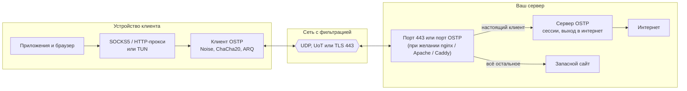

# OSTP - Ospab Stealth Transport Protocol

[English](README.md) · [Документация](docs/README.md) · [Журнал изменений](CHANGELOG.ru.md) · [Releases](https://github.com/ospab/ostp/releases) · [Wiki](https://github.com/ospab/ostp/wiki) · [Участие в разработке](CONTRIBUTING.ru.md)


OSTP — зашифрованный туннель на Rust для сетей, где трафик фильтруют (DPI). Клиент на компьютере или телефоне отправляет весь трафик,
или только выбранные приложения и сайты, через ваш собственный сервер. Протокол, сервер, утилита командной строки, десктопное и
Android-приложения лежат в этом репозитории.

Как это выглядит на проводе, зависит от выбранного носителя (то, что лежит под OSTP):

- **UDP**: каждый байт, включая заголовки, неотличим от случайных данных; надёжность своя (выборочные ACK/NACK, контроль перегрузки).
- **UoT** (UDP поверх TCP): те же пакеты внутри обычного TCP-соединения — для сетей, где незнакомый UDP блокируют или режут.
- **TLS**: UoT внутри настоящего TLS с настоящим сертификатом на вашем домене, на порту 443, напрямую или за nginx, Apache или Caddy по
  секретному пути. Для всех остальных сервер выглядит обычным сайтом.

---

## Установка

**Сервер или клиент командной строки, Linux:**
```bash
bash <(curl -Ls https://raw.githubusercontent.com/ospab/ostp/master/scripts/install.sh)
```

**Windows (PowerShell от имени администратора):**
```powershell
irm https://raw.githubusercontent.com/ospab/ostp/master/scripts/install.ps1 | iex
```

Скрипты ставят стабильный выпуск. Канал предварительных выпусков (`beta`, `alpha`) выбирается ключом `-b`: на Linux
`bash <(curl -Ls https://raw.githubusercontent.com/ospab/ostp/master/scripts/install.sh) -b beta` (`-v ВЕРСИЯ` выбирает точный выпуск),
в установленном `ostp` — `ostp update -b beta`. `ostp -V` печатает версию с каналом, например `0.5.0-beta.1`.
Удаление: `ostp uninstall` оставляет конфиг, `ostp uninstall --purge` удаляет и конфиг, сертификаты и все ключи пользователей,
`--yes` убирает вопрос.

**Приложения:** десктопный клиент (Windows, Linux, macOS) и Android-приложение (arm64, armv7) — на странице [Releases](https://github.com/ospab/ostp/releases),
там же готовые бинарники `ostp` для Windows, Linux (x86, x64, ARM, MIPS, RISC-V), macOS и FreeBSD.

---

## Быстрый старт

**Не знакомы с Linux?** Установите десктопное приложение и на первом экране выберите «I have a server» (или позже: *Settings → Server management*).
Введите адрес VPS, логин SSH и пароль или приватный ключ: приложение само поставит OSTP по SSH, добавит себе подключение,
а дальше управляет сервером: пользователи, трафик, TLS-сертификат, подписки, обновления, логи и веб-панель через то же SSH-соединение.
Пароль или ключ SSH сохраняется, только если вы попросите, и зашифрован ключом из системного хранилища; ключ хоста сервера запоминается при первом подключении.

**Вручную. 1. На сервере** запустите мастер настройки и выведите ссылки для подключения:

```bash
ostp setup           # режим сервера, порт, ключи доступа
ostp links           # ссылки ostp://... для каждого пользователя
ostp links qr        # то же QR-кодами, по одному пользователю
```

Новая установка создаёт собственный ключ сервера. Его открытая часть — параметр `pk=` в каждой ссылке: по нему клиент проверяет сервер и
говорит по протоколу v6. Ссылка без `pk=` работает по старому протоколу v5, где сервер не проверяется. Сервер, обновлённый с 0.4.x, ключа не имеет,
пока вы не выполните `ostp key server new` (выданные раньше ссылки перестанут работать); `ostp key legacy on|off` оставляет или прекращает
поддержку клиентов старше 0.5.0.

**2. На клиенте** вставьте ссылку в десктопное или Android-приложение либо используйте командную строку:

```bash
ostp connect "ostp://ACCESS_KEY@server.example.com:50000?..."   # подключиться один раз
ostp import  "ostp://..."                                      # сохранить в конфиг
```

Ссылку берите в кавычки, иначе оболочка обрежет её на `&` или `?`.

**3. По желанию, на сервере с доменом:**

```bash
ostp cert issue --domain vpn.example.com   # HTTPS и сертификат Let's Encrypt, носитель TLS на 443
ostp sub enable                            # персональные ссылки подписки, приложения обновляют их сами (у каждого случайный id)
ostp panel enable                          # веб-панель и API управления
ostp dns enable                            # фильтрующий DNS для подключённых клиентов
```

Подробнее: [Домены и TLS](docs/ru/tls.md), [Сервер](docs/ru/server.md), [Клиент](docs/ru/client.md).

---

## Что внутри

- Три носителя под OSTP: UDP, UoT (UDP поверх TCP) и TLS на 443 с настоящим сертификатом, напрямую или за веб-сервером.
- Протокол v6: клиент проверяет сервер по его ключу (`pk=` в ссылке); потоки упорядочиваются отдельно, так что потерянный пакет не задерживает остальные;
  сервер сообщает клиенту, почему закончил сессию (ключ удалён или истёк, лимит исчерпан, сервер останавливается).
- MTU пути определяется автоматически (по UDP), застой пути обнаруживается, а сервер сам ограничивает отправку тем, что принимает клиент.
- Всё, что не является настоящим клиентом, получает запасной сайт или ответ-приманку.
- Локальный SOCKS5/HTTP-прокси (и системный прокси Windows) или TUN-адаптер (с kill switch на Linux и macOS).
- Домены, диапазоны IP и, на Windows и Linux, процессы можно исключить из туннеля.
- При смене сети или зависшем пути сессия переходит на новый сокет без нового рукопожатия. Если путь потерян, клиент сам переподключается
  на том же носителе; сам носитель он никогда не меняет, это выбор пользователя.
- Персональные ссылки подписки, которые можно заменить без смены ключа, веб-панель с REST API и фильтрующий DNS для подключённых клиентов.
- Ограничения на ключ: трафик, срок действия и число устройств (идентификатор устройства уходит серверу подписки, только если вы включили `send_hwid`; по умолчанию выключено).
- Сервер может рассказать клиентам о себе (название, место, контакт, текст); это идёт только внутри туннеля и показывается в приложениях.
- Приватность логов: `strict`, `normal` (по умолчанию) или `debug`; вне `debug` в логах нет сайтов и DNS-имён, адреса клиентов обрезаны или заменены меткой.
- Cloudflare WARP как выход сервера (`ostp warp`), по желанию.
- Пробер сети: пробует все носители до вашего сервера и находит оборудование фильтрации по TTL.
- Исходящий трафик сервера можно пустить через SOCKS5-прокси по правилам или с выбранного адреса.
- По желанию сайты `.ov` через [overnet](https://github.com/ospab/overnet); по умолчанию выключено.
- Приложения управляют сервером по SSH (пользователи с лимитами и сроком, устройства, сведения о сервере), предупреждают о профиле без ключа сервера
  и спрашивают, принимать ли ключ сервера, изменившийся при обновлении подписки.

Рукопожатие — `Noise_NKpsk0_25519_ChaChaPoly_BLAKE2s` в v6 (клиент знает ключ сервера) и `Noise_NNpsk0_25519_ChaChaPoly_BLAKE2s` в v5,
ChaCha20-Poly1305 на каждый пакет; см. [спецификацию](docs/ru/specification.md) и [Протокол v6](docs/ru/v6-design.md).

---

## Как это устроено



---

## Команды

```
ostp [--config ПУТЬ] [КОМАНДА]
```

| Команда | Что делает |
|---|---|
| *(без команды)* | Запуск клиентом или сервером, как указано в конфиге |
| `setup` | Мастер настройки; спрашивает, прежде чем заменить существующий конфиг |
| `init server\|client\|relay` | Записать шаблон конфига; существующий заменяется только с `--force` (копия с датой сохраняется) |
| `check` | Проверить конфиг и вывести сводку |
| `start`, `stop`, `restart` | Управлять службой `ostp` (Linux, её регистрирует `setup`) |
| `status` | Запущен ли ostp, с какого времени, и последние строки журнала |
| `log [-n N] [-f]` | Журнал: журнал службы на Linux, `ostp.log` на других системах; `-f` показывает новые строки; `log privacy [strict\|normal\|debug]` показывает или задаёт, что в нём пишется |
| `connect <URL>` | Подключиться один раз по ссылке `ostp://` |
| `import <URL>` | Сохранить в конфиг ссылку `ostp://` или ссылку подписки |
| `links [qr]` | Вывести ссылки `ostp://` пользователей или показать их QR-кодами (`--all`: код для каждой ссылки) |
| `key` | Ключ сервера и ключи доступа (сервер): состояние, `gen` (`--format hex\|base64`, `-n` количество, `--add`), `server [new]`, `legacy on\|off` |
| `manage ...` | Пользователи, лимиты и состояние сервера: текст в терминале, JSON для приложений (сервер). `status`, `users`, `user-add`, `user-set` (`--name`, `--limit-bytes`, `--devices`, `--expires`, `--new-sub-id`), `user-remove`, `user-devices`, `sub-ids`, `server-info`, `logs`, `restart` |
| `cert issue\|status\|renew` | Домен, HTTPS и сертификат Let's Encrypt (сервер) |
| `sub status\|enable\|disable\|set\|urls` | Ссылки подписки (сервер) |
| `panel status\|enable\|disable\|set\|passwd\|token` | Веб-панель и API управления (сервер) |
| `dns status\|enable\|disable\|...` | Фильтрующий DNS для клиентов (сервер) |
| `warp register\|enable\|disable\|status\|test\|...` | Cloudflare WARP как выход сервера (сервер) |
| `overnet status\|install\|enable\|disable\|exit` | Сайты `.ov` для клиентов через overnet (сервер) |
| `hash-password` | Хэш пароля для конфига панели |
| `migrate [--dry-run]` | Обновить конфиг до текущего формата; сама программа этого никогда не делает |
| `update [-b stable\|beta\|alpha] [-v ВЕРСИЯ]` | Установить другой выпуск |
| `changelog`, `cl` | Что изменилось в этой версии (`--all`, `--last N`, `--version X`, `--lang en\|ru`) |
| `proxy-env`, `proxy-env-clear` | Команды export для локального прокси |
| `uninstall [--yes] [--purge]` | Остановить службу и удалить бинарник; конфиг остаётся, если нет `--purge` |

Конфиг — `/etc/ostp/config.json` на Linux и `config.json` в текущей папке на Windows; другой файл задаётся через `--config`. У каждой
команды есть `--help`.

---

## Документация

Оглавление: [docs/README.md](docs/README.md). Чаще всего нужны:

- [Клиент](docs/ru/client.md) и [Сервер](docs/ru/server.md)
- [Домены и TLS](docs/ru/tls.md)
- [Спецификация протокола](docs/ru/specification.md), [Протокол v6](docs/ru/v6-design.md), [Обфускация](docs/ru/obfuscation.md), [Архитектура](docs/ru/architecture.md)
- [Интеграции и API управления](docs/ru/integrations.md)
- [Протокол тестирования](docs/ru/testing.md) перед каждым выпуском
- [Журнал изменений](CHANGELOG.ru.md)

---

## Сборка из исходников

```bash
cargo build --release     # бинарник ostp: target/release/ostp
```

Нужна актуальная стабильная версия Rust. Тесты и крупные сборки идут на GitHub Actions, а не на машине разработчика ([CONTRIBUTING.ru.md](CONTRIBUTING.ru.md)). У десктопного и Android-приложений свои шаги: [ostp-gui](ostp-gui/README.md), [ostp-flutter](ostp-flutter/README.md).
Как устроен репозиторий и как присылать изменения: [CONTRIBUTING.ru.md](CONTRIBUTING.ru.md).

---

## Безопасность

О уязвимостях сообщайте закрыто, не в публичном issue: см. [SECURITY.ru.md](SECURITY.ru.md).

## Лицензия

GNU Affero General Public License v3.0 (AGPL-3.0), см. [LICENSE](LICENSE).

## Контакты

- Telegram: [@ospab0](https://t.me/ospab0)
- Email: gvoprgrg@gmail.com
